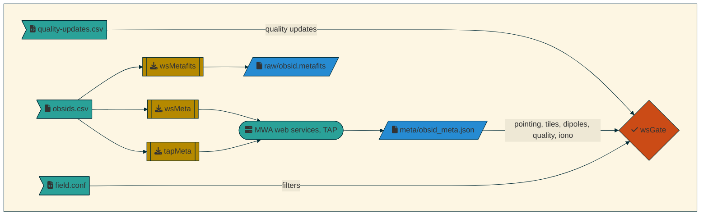
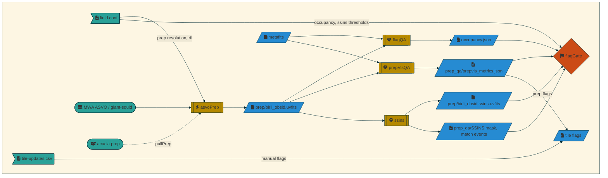
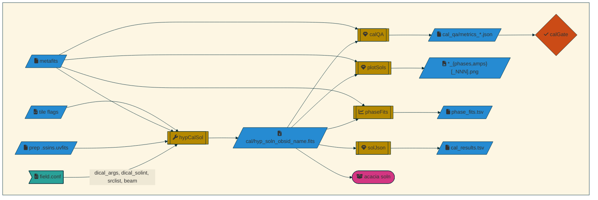
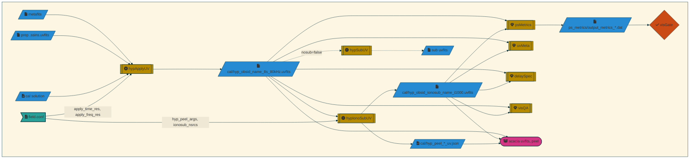
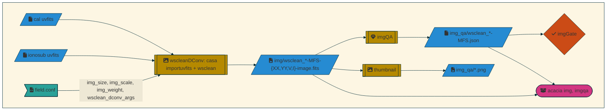

# MWA EoR Nextflow Pipeline

A [Nextflow](https://www.nextflow.io/) DSL2 pipeline that takes a list of MWA obsids and turns
them into quality metrics, calibrated visibilities, images and CHIPS power spectra. Each stage ends
in a gate that stops an observation going further when a problem is found, so the power spectra at
the end only integrate the observations that pass every check.

Operational notes for running and debugging it on a cluster are in [AGENTS.md](AGENTS.md).

## Flow

### Metadata



The metadata stage gathers information about each observation from MWA web services and the TAP
service: scheduling, pointing, faults, flagged tiles and dipoles, data quality, ionospheric QA and
archive status. `wsGate` rejects observations that fail the `filter_*` params of the conf (field,
band, pointing, sun elevation, array configuration, bad tile and dead dipole fractions, quality)
before anything is downloaded.

### Preprocessing and flagging



Preprocessed uvfits visibilities come from [Birli](https://github.com/MWATelescope/Birli) via
[MWA ASVO](https://asvo.mwatelescope.org/) ([giant-squid](https://github.com/MWATelescope/giant-squid)
submits the conversion job and downloads the result when ready), or from Acacia when `pullPrep` is
set, or from a local Birli run on raw gpubox files with `-entry asvoRawFlow`. Phase III nights are
preprocessed at native resolution with AOFlagger off (`cal_suffix = "_norfi"`).

`flagQA` measures flag occupancy per coarse channel, [`prepVisQA`](https://github.com/Chuneeta/mwa_qa)
measures autocorrelation RMS per tile (grouped by cable flavour, antenna family or receiver so a
whole signal-path group is not flagged at once) and produces the list of outlier tiles, and
[SSINS](https://github.com/mwilensky768/SSINS) flags RFI and writes the `.ssins.uvfits` copy that
every later stage uses. `flagGate` rejects observations whose total, RFI or SSINS occupancy, SSINS
streak, narrow-band or DAB fractions, or bad-tile fraction exceed the conf thresholds. Manual flags
from `tile-updates.csv` and the prepVisQA outliers are carried forward as calibration tile flags.

### Direction independent calibration



[Hyperdrive](https://github.com/MWATelescope/mwa_hyperdrive) `di-calibrate` solves for one
direction independent solution per observation (or one per `dical_solint` timeblock) against the
LoBES-based source list with the full embedded element beam. Solutions are analysed by
[`calQA`](https://github.com/Chuneeta/mwa_qa) (RMS convergence, unused baselines, unconverged
channels, bad tiles), plotted, and their phases fitted per tile; `calGate` rejects observations
whose calQA metrics exceed the conf limits. Tiles that calQA finds bad are added to the apply flags.

### Calibrated visibility analysis



`hypApplyUV` applies the solution (with the manual, prepVisQA and calQA tile flags) and averages
to the apply resolution, 8 s and 80 kHz by default. `hypIonoSubUV` runs hyperdrive `peel`, which
subtracts the brightest `sub_nsrcs` sources and fits ionospheric offsets for the brightest
`ionosub_nsrcs` of them, writing the `ionosub` visibilities and the per-source ionospheric constants
JSON. Plain model subtraction (`sub`) is available with `nosub = false`. Both the unsubtracted and
subtracted visibilities are measured by [`ps_metrics`](https://github.com/cathryntrott/chips) (EoR
window and wedge power); `visGate` rejects observations with too much window power, or too high or
low a window to wedge ratio, before and after subtraction. `uvMeta`, `delaySpec` and (for compact
configurations) `visQA` add per-observation plots and metrics.

### Image analysis



When imaging is enabled (`noimg = false`) each calibrated and subtracted uvfits is converted to a
measurement set inside the task and imaged with [wsclean](https://gitlab.com/aroffringa/wsclean)
(multiscale clean, XX, YY, V and I). [`imgQA`](https://github.com/Chuneeta/mwa_qa) measures the
Stokes V RMS and the integrated flux of PKS0023-026 in each polarisation; `imgGate` rejects
observations with too much V power or with a poor subtraction of the calibrator. The ph3 confs
leave imaging off by default and use it for diagnostics.

### Power spectra

```mermaid
%%{init:{'theme':'base','themeVariables':{'primaryBorderColor':'#002b36','secondaryColor':'#eee8d5','tertiaryColor':'#fdf6e3','tertiaryBorderColor':'#002b36','lineColor':'#002b36','textColor':'#002b36'}}}%%
graph TD;
  classDef in fill:#2aa198;
  classDef out fill:#d33682;
  classDef file fill:#268bd2;
  classDef proc fill:#b58900;
  classDef decision fill:#cb4b16;

  subgraph "chips"
    uvfits --> group --> storeManifest --> manifest
    group --> chipsGrid --> chipsGridOut --> chipsCombine --> chipsCombineOut
    chipsCombineOut --> chipsLssa --> chipsLssaOut --> chipsPlot & chips1dTsv

    uvfits[/fa:fa-file cal and ionosub uvfits that pass visGate/]; class uvfits file;
    group{{"fa:fa-layer-group group by field, band, config (date, pointing, lst) in chunks of chunkSize"}}; class group decision;
    storeManifest[[fa:fa-list storeManifest]]; class storeManifest proc;
    manifest[/"fa:fa-file group/manifest_group.csv"/]; class manifest file;
    chipsGrid[["fa:fa-times-circle chipsGrid: gridvisdiff, prepare_diff"]]; class chipsGrid proc;
    chipsGridOut[/"fa:fa-file group/ps_metrics/name/{vis_tot,vis_diff,noise_tot,noise_diff,weights}_pol.obsid_name.dat"/]; class chipsGridOut file;
    chipsCombine[[fa:fa-times-circle chipsCombine: combine_data]]; class chipsCombine proc;
    chipsCombineOut[/"fa:fa-file *_pol.group_name.dat"/]; class chipsCombineOut file;
    chipsLssa[["fa:fa-times-circle chipsLssa: lssa_fg_general, bias mode b11"]]; class chipsLssa proc;
    chipsLssaOut[/"fa:fa-file group/lssa_fg_general_b11/name/{crosspower,residpower,totpower,flagpower,fg_num,outputweights}_pol_0.iter.group_name.dat"/]; class chipsLssaOut file;
    chipsPlot[["fa:fa-chart-area chipsPlot: 1D, 2D png"]]; class chipsPlot proc;
    chips1dTsv[[fa:fa-table chips1d_tsv: 1D_power tsv]]; class chips1dTsv proc;
  end
```



Observations that pass every gate are grouped by field, band and array configuration (optionally
also by date, pointing or LST, or a `groupSuffix`), chunked, gridded with
[CHIPS](https://github.com/cathryntrott/chips), combined per chunk and transformed to 2D and 1D
power spectra with `lssa_fg_general`. Chunk directories carry a hash of their obsid list and a
manifest, so the same group can be rebuilt or compared later.

## Output directory structure

Everything is written through Nextflow `storeDir`, so a product that already exists is reused
and the task is skipped. Suffix params (`prep_suffix`, `cal_suffix`, `img_suffix`, `peel_suffix`,
`dical_name`) are what keep different configurations apart on disk.

- `${params.outdir}/`
  - `${obsid}/`
    - `raw/` - metafits (and gpubox fits for `asvoRawFlow`)
    - `raw_qa/` - antenna and channel tables
    - `meta/` - `${obsid}_meta.json` from web services and TAP, inputs tsv, sky map png
    - `prep/` - `birli_${obsid}${prep_suffix}.uvfits` and the SSINS-flagged `.ssins.uvfits`
    - `prep_qa/` - SSINS mask, match events and plots, prepVisQA metrics json and flag tsv
    - `cal${cal_suffix}/` - `hyp_soln_*.fits`, di-cal, apply and peel logs, calibrated and
      ionosub uvfits, `hyp_peel_*_uv.json` ionospheric constants
    - `cal_qa${cal_suffix}/` - calQA metrics json, solution amp/phase plots (one per timeblock),
      phase fit tsv and plots, solution json
    - `vis_qa${cal_suffix}/` - uvMeta json, delay spectrum plots, visQA json
    - `ps_metrics${cal_suffix}/` - `output_metrics_*.{xx,yy,xy}.dat` and per-vis CHIPS grids
    - `img${img_suffix}${cal_suffix}/` - wsclean MFS images and source lists
    - `img_qa${img_suffix}${cal_suffix}/` - imgQA json and thumbnails
  - `${group}_${chunkhash}/` - one per CHIPS chunk, e.g. `eor0low_phase3_be56c57b`
    - `manifest_${group}_${chunkhash}.csv` - obsids in the chunk
    - `ps_metrics${cal_suffix}/${name}/` - gridded and combined CHIPS data
    - `lssa_fg_general${cal_suffix}_b${bias}/${name}/` - power spectra dat, 1D tsv, 1D and 2D png
- `${params.resultsdir}/results${obsids_suffix}${result_suffix}${img_suffix}${cal_suffix}/`
  - aggregate tsvs and plots for the run:
  `ws_obs_pass.csv`, `prep_subobs_name_pass.csv`, `fail_counts_all.tsv`, `lst_counts_all.tsv`,
  `reasons_*.tsv`, `cal_metrics_*.tsv`, `cal_results*.tsv`, `calqa_*.tsv`, `phase_fits_*.tsv`,
  `ps_metrics*.tsv`, `chips1d_*.tsv` and scatter plots of each, plus `logs/` for the run.

## Configuration

Defaults live in `nextflow.config`; a per-field conf (`eor0high-ph3.conf`, `eor0low-ph3.conf`,
`eor1high-ph3.conf`, `cenA-ph3.conf`) overrides them with `-c`, and any param can also be set on the
command line (`--param=value`). The first comment line of each conf is its launch command.

### obsids

`obsids.csv` holds one obsid per line (an optional second column is kept as metadata; `#` starts a
comment). `--obsids_suffix=-foo` reads `obsids-foo.csv` instead, and the suffix also names the
results directory.

### direction-dependent self-calibration

`--noddcal=false` adds a DD self-cal pass after the DI calibration has been applied. The
directions are the `ddcal_nsrcs` brightest sources (through the beam) of the reduced source list
(`hypDDDirections`); `ddcal_prog` picks the implementation:

- `hyp` (uvfits, `hypDDCalSol`): everything but the directions is subtracted with the DI model
  (`ddcal_sub_nsrcs` sources), then each direction is isolated by subtracting the other directions
  and solved on its own with a constrained `hyperdrive di-calibrate`
  ([mwa_hyperdrive#105](https://github.com/MWATelescope/mwa_hyperdrive/pull/105)): one solution file
  per direction, `cal/hyp_soln_<obsid>_dd<i>_<ddcal_name>_<vis name>.fits`, plotted into `cal_qa/`,
  with the per-direction convergence collected in `ddcal.tsv`.
- `dp3` (measurement set, `dp3DDCal`): the reduced source list is converted to a DP3 sky model with
  one patch per direction (`ddSkymodel`), the field is subtracted with `predict`, and all directions
  are solved together by `DDECal`, writing the H5Parm solutions and the DD-subtracted MS. Needs
  `dp3` on the PATH or `dp3_sif`.
- `both` runs both.

`ddcal_mode` and `ddcal_smoothness*` use DP3's names and units for both implementations
(`mode`, `smoothnessconstraint`, ...): `tec+phase+delay` (the default) fits a phase per tile that is
`a/ν + b + cν` across the band, `diagonal` with `ddcal_smoothness = '2MHz'` solves smoothed complex
gains. hyperdrive additionally accepts `delay` and `phase+delay` (phase linear in frequency).
`ddcal_solint`, `ddcal_uvw_min` and `ddcal_max_iterations` map onto `solint`, `uvlambdamin` and
`maxiter`. Note hyperdrive solutions apply as `J·V·Jᴴ` while DP3's gains are `G⁻¹·V·G⁻ᴴ`, i.e.
`J = G⁻¹`; the constraints are applied to `G` in both. The hyperdrive path does not yet produce a
DD-subtracted uvfits (hyperdrive has no inverse `solutions-apply`); the DP3 path does.

### filters and gates

`filter_*` params control the metadata gate (field, band, phase centre, pointings, sun elevation,
array configuration, bad tile and dead dipole fractions, data quality, ionospheric QA), the flag
gate (`flag_occupancy_threshold`, `rfi_occupancy_threshold`, `ssins_*_threshold`), the calibration
gate (`filter_max_rms_convg`, `filter_max_unused_bl_frac`, `filter_max_unconvg_chs`), the
visibility gate (`filter_{max,min}_ps_*`) and the image gate (`filter_*_vrms_box_*`,
`filter_*_pks_int_*`). `null` disables a filter. The reason an observation stopped is recorded as a
fail code in the results tsvs (see `getFailReason` in `modules/utils.nf`, or the table in
[AGENTS.md](AGENTS.md)).

### quality updates

If obsids are known to be bad but the MWA metadata database has not been updated, list them in
`quality-updates.csv` as `obsid,dataquality,comment`; they are then rejected by `filter_quality`.

### tile updates

Tiles that need manual flagging over a range of obsids go in `tile-updates.csv` as
`startgps,endgps,tiles,comment`, where `tiles` are pipe separated tile indices as used in the
metafits `TILE_DATA` HDU and in hyperdrive solution plots (so `Tile061` is index 40, not 61):

```txt
1125766160,1125767872,40|41|42|43|44|45|46|47,chaotic fringes in high channels on recv06
1126921360,1126923520,55,Tile98 fringes
```

### di-cal args

`dical_name` names the solution (it appears in every downstream filename) and `dical_args` is passed
to `hyperdrive di-calibrate`, e.g.

```groovy
dical_name = "30l_src8k_300it"
dical_args = "-n 8000 --uvw-min 30l --max-iterations 300 --stop-thresh 1e-20 --freq-average 40kHz"
```

Hyperdrive produces one solution (timeblock) per observation by default. Set `dical_solint` to
calibrate in shorter timeblocks, e.g. `dical_solint = "40s"` (passed as `--timesteps-per-timeblock`);
give `dical_name` a matching suffix so the solutions do not collide with the single-timeblock ones,
and expect a higher RMS convergence per timeblock. Multi-timeblock solutions get one row per
timeblock in `cal_results.tsv` and one plot per timeblock.

`hyp_srclist_args`, `sourcelist` and `beam_path` select the sky model and beam; use the full
embedded element pattern for the low band (the 167-197 MHz interpolated file only covers the high
band).

### apply, subtraction and chips

`apply_time_res` and `apply_freq_res` (8 s, 80 kHz) set the calibrated resolution. `hyp_peel_args`,
`sub_nsrcs` and `ionosub_nsrcs` configure `hypIonoSubUV`; `peel_suffix` keeps peel variants apart;
`nosub` and `noionosub` switch the subtractions. `lssa_bias_mode`, `lssa_bin`, `chunkSize`,
`groupByDate`, `groupByPointing`, `groupByLst` and `groupSuffix` control CHIPS grouping; `kperp_*`
and `kparra_*` set the 1D cuts.

### switches and suffixes

Most stages have a `no*` switch (`noprep`, `nossins`, `nocal`, `noapply`, `noimg`, `nochips`,
`novideo`, `nothumbnail`, `nopolcomp`, ...). `cal_suffix`, `img_suffix`, `result_suffix`,
`prep_suffix` and `peel_suffix` namespace the products of a configuration so that several can
coexist. Archiving to Acacia is off unless `archive = true`; `bucket_prefix` picks the bucket set,
and `pullPrep` / `pullCalSol` fetch existing products instead of recomputing them.

## Usage

From the checkout, inside `tmux`, with a profile for your cluster (see `profiles` in `nextflow.config`):

```bash
export MWA_ASVO_API_KEY=...   # only needed when new obsids must be downloaded
nextflow run main.nf -profile <profile> -c eor0low-ph3.conf \
  --obsids_suffix=-eor0low20260903 --nothumbnail --nopolcomp --novideo -name <run name>
```

Entry points: the default workflow starts from the obsid list and does everything; `-entry
asvoRawFlow` downloads raw files and preprocesses locally; `-entry extPrep` starts from
preprocessed files already on disk; `-entry extChips` runs CHIPS on existing visibilities.
See [AGENTS.md](AGENTS.md) for the full list, the `storeDir` rules, queue behaviour, debugging
commands and the other things that are not obvious from the code.

Handy Nextflow commands:

```bash
# tasks of the last run with their work dirs and timings
nextflow log "$(nextflow log -q | tail -n 1)" -f workdir,exit,status,process,tag,duration,realtime,peak_vmem
# failures and warnings in a run log
grep -E '(COMPLETED; exit: [^0]|WARN|ERROR|unable to find)' <run>.nextflow.log
# all your pipeline jobs
squeue -u $USER --format "%.10i %.40j %.2t %.8M %R"
```

Pawsey (Garrawarla, Setonix) profiles remain in `nextflow.config` for reference but are not
maintained.
